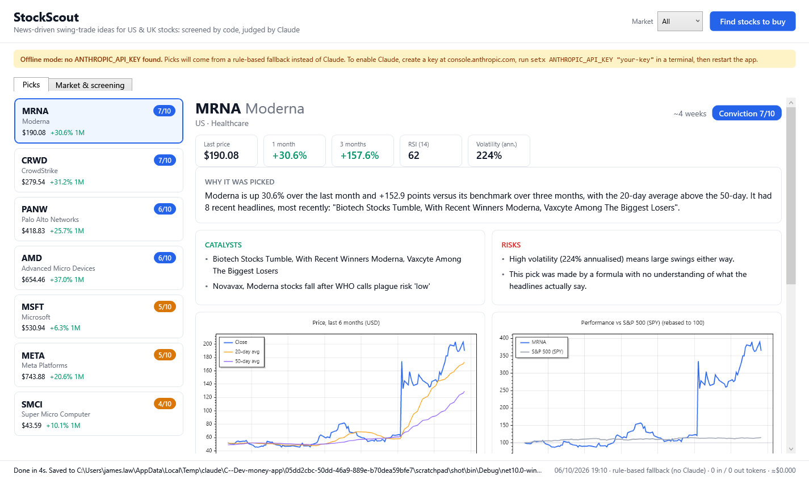
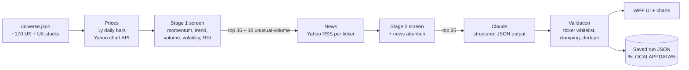
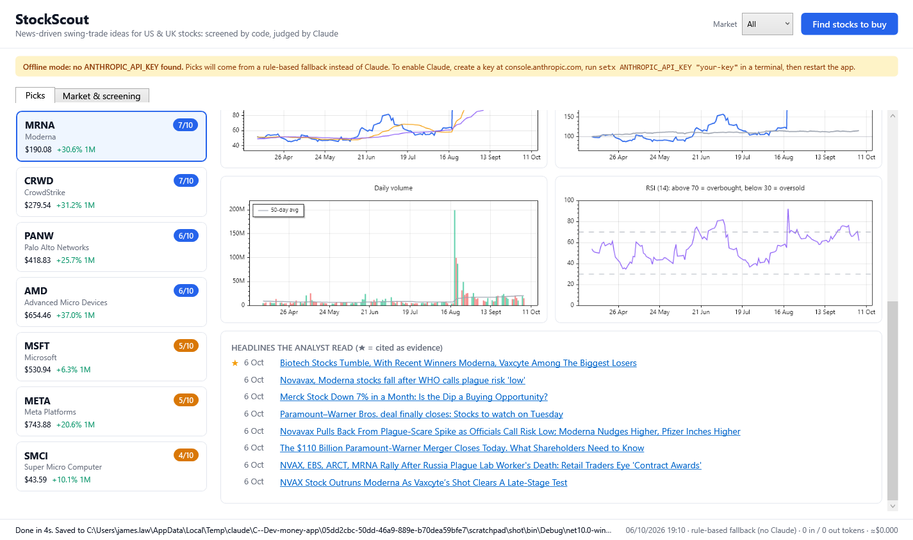
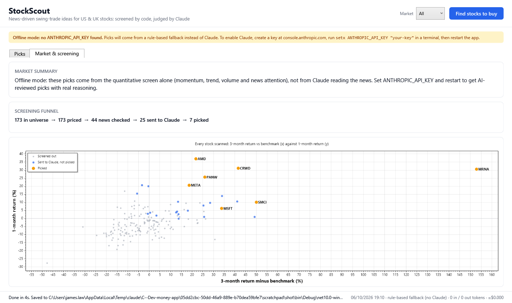

# StockScout

A Windows desktop app (WPF, .NET 10) that answers one question with one button: **"What should I buy right now?"**

It scans ~170 large US and UK stocks, screens them on price action, reads the latest headlines for the strongest
candidates, and asks Claude to pick 5-10 swing-trade ideas (a few weeks' horizon) with a plain-English thesis,
catalysts, risks and the headlines that back each one up. Every pick comes with charts.

> Educational project. Not financial advice. If you use the output, use it with trivial sums.



## Running it

```bash
dotnet run --project src/StockScout.App
```

To get Claude's picks, create an API key at [console.anthropic.com](https://console.anthropic.com), then:

```bash
setx ANTHROPIC_API_KEY "your-key"
```

Restart the app (or your terminal) afterwards. Without a key the app still runs end to end in **offline mode**,
using a rule-based fallback analyst, and a banner makes that obvious.

A run takes about 15-30 seconds. Each Claude call costs roughly 5-15 US cents with Sonnet 5.5; the cost of every
run appears in the footer.

Run the tests:

```bash
dotnet test
```

## How it works



| Step | Where | Notes |
|---|---|---|
| Universe | `src/StockScout.Core/universe.json` | Editable without recompiling. Benchmarks: SPY (US), FTSE 100 (UK). |
| Prices and news | `Data/YahooFinanceClient.cs` | Free and keyless, but unofficial. Hidden behind `IPriceDataProvider` / `INewsProvider`. Six concurrent requests, retries with backoff. |
| Indicators | `Analysis/Indicators.cs` | SMA, Wilder RSI, returns, annualised volatility, volume ratio, relative strength. |
| Screening | `Analysis/Screener.cs` | Deterministic z-score model, clamped to ±3 so outliers can't dominate. |
| Prompt | `Ai/AnalystPrompt.cs` | Compact text table per stock, numbered headlines, plus a strict JSON schema. |
| LLM call | `Ai/ClaudeStockAnalyst.cs` | Official Anthropic C# SDK, structured outputs, server-side refusal fallback. |
| Validation | `Ai/AnalystResponseParser.cs` | Never trusts the LLM's output as-is. |
| Orchestration | `Pipeline/PickPipeline.cs` | Reports progress, supports cancellation, and one failing ticker never kills a run. |
| UI | `src/StockScout.App` | MVVM with CommunityToolkit.Mvvm. Charts with ScottPlot. |




## Design decisions (and why)

**Hybrid: code screens, the LLM judges.** Sending 170 stocks' news to an LLM would be slow, expensive and hard to
reason about. Letting a formula pick stocks ignores what the news actually *says*. So deterministic code narrows the
field to 25 on measurable signals, and Claude only does the part code is bad at: reading headlines and weighing
catalysts against risks. The offline fallback shows the difference clearly. On the day this was built, the formula
ranked Moderna first because of a 150% three-month move, while its headlines said the plague-scare rally was already
reversing. A model that reads the news would pass on it.

**Structured output plus validation instead of trusting the model.** The response is constrained by a JSON schema,
so it always parses. On top of that, `AnalystResponseParser` drops tickers that weren't in the shortlist (a guard
against hallucination), removes duplicates, clamps conviction to 1-10, discards headline references that don't exist,
and caps the list at 10. Every rule has a unit test.

**Prompt-injection awareness.** Headlines are third-party text. They are delimited in the prompt, and the model is
told to treat them as data, not instructions. Links from the feed are only opened if they're http or https.

**Interfaces at the boundaries.** Yahoo is unofficial and could break tomorrow. Swapping it for Finnhub, Polygon or
another source means writing one class. The pipeline tests run entirely on fakes, with no network calls and no API
spend.

**Testable core, thin UI.** All the logic lives in a plain class library with no WPF dependency. The UI is view
models plus XAML. ScottPlot isn't data-bindable, so chart drawing lives in a small renderer called from view
code-behind. That's a deliberate, contained exception to MVVM.

**Graceful degradation.** No API key means offline mode instead of a crash. A failed ticker drops out of the run.
Rate limits get retried. Errors that the user can fix (a bad key, a refusal, running out of tokens) produce
plain-English messages.

**Cost visibility.** Each run shows tokens in and out and the estimated cost, and the screen keeps the prompt to
roughly 15k tokens.

## Known limitations

- **No backtest yet.** Nothing here proves the picks beat the market. Runs are saved with entry prices
  (`%LOCALAPPDATA%\StockScout\runs`) so that can be measured later.
- **Survivorship bias.** The universe is today's large caps, which makes past momentum look better than it was.
- **Thin news.** Headlines and short summaries only, from a single free feed, and the LLM never reads the full
  articles.
- **LLMs are not calibrated forecasters.** The conviction score is the model's opinion, not a probability.
- **Data quality.** The Yahoo endpoints are unofficial and undocumented.

## Ideas for next steps

1. **Track record tab:** reload saved runs, fetch current prices, and chart each pick's return against the benchmark
   since it was recommended. This is the single most valuable addition.
2. **Evals:** a fixed set of historical snapshots to compare prompts or models on the same inputs.
3. **Model selector** in the UI (Haiku, Sonnet or Opus), comparing quality against cost.
4. **Let Claude fetch full articles** for its shortlist with the web fetch tool.
5. **Caching** of price data so repeat runs within a day are instant.

## Tech

.NET 10, WPF, CommunityToolkit.Mvvm, ScottPlot 5, the official `Anthropic` C# SDK, and xUnit.
